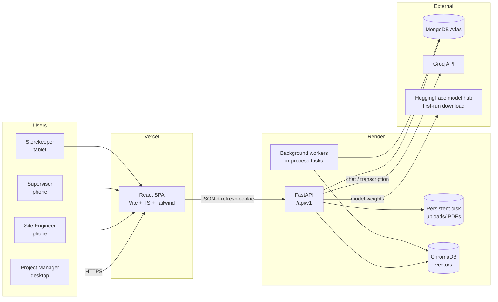
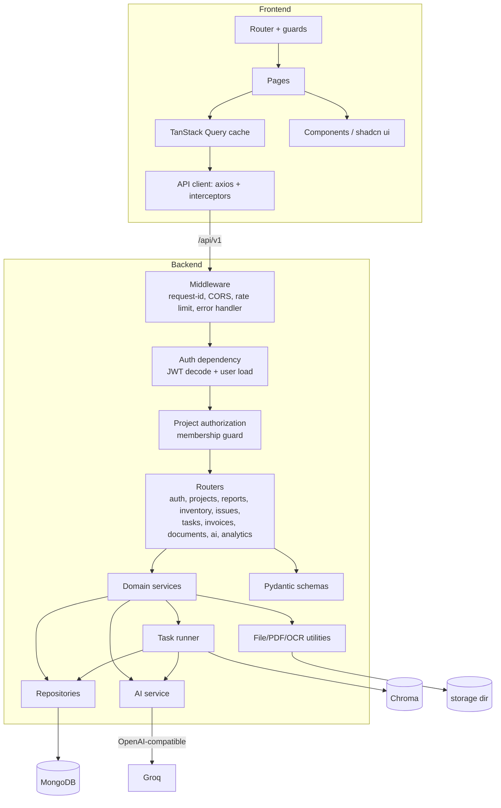
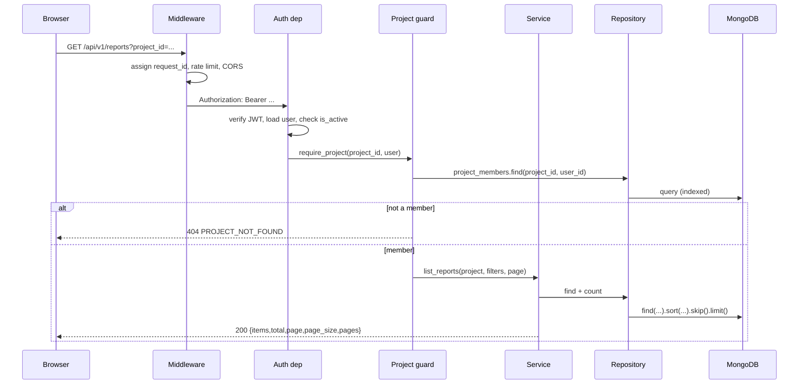
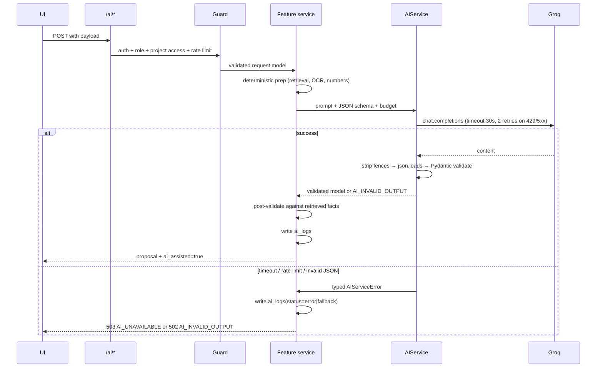
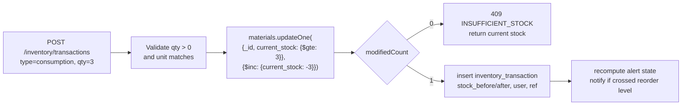
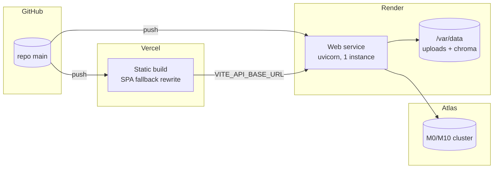

# 02 — Architecture

## 1. Style

A **modular monolith**: one FastAPI deployable, one React SPA, one MongoDB database, one local Chroma store. Modules are separated by directory and dependency direction, not by network calls. This keeps operational cost low (portfolio scale) while preserving clean boundaries that could be split later.

Guiding rules:

1. Routers do HTTP only: parse, authorize, delegate, serialize.
2. Services own business rules and are the only callers of repositories.
3. Repositories own Mongo queries; no raw `db.collection` access outside them.
4. AI providers are reached only through `AIService`.
5. Deterministic math (stock, totals, risk scores) never goes through an LLM.

## 2. System context



## 3. Containers and responsibilities



## 4. Backend module layout

```
backend/app/
├── main.py                  app factory, lifespan (mongo connect, index init, model warmup), routers
├── api/
│   ├── deps.py              get_current_user, require_roles, get_project_access, pagination
│   └── v1/
│       ├── auth.py  projects.py  reports.py  inventory.py
│       ├── issues.py  tasks.py   invoices.py  documents.py
│       └── ai.py   analytics.py  health.py
├── core/
│   ├── config.py            pydantic-settings, env parsing, validation
│   ├── security.py          hashing, token issue/verify, cookie helpers
│   ├── permissions.py       role matrix + project membership resolution
│   ├── errors.py            AppError hierarchy, error envelope, exception handlers
│   ├── logging.py           structured JSON logs, request id
│   ├── rate_limit.py        in-process sliding window per user/route
│   └── constants.py         enums: roles, statuses, categories, units
├── database/
│   ├── mongo.py             client, db, ping, graceful shutdown
│   ├── indexes.py           idempotent index creation
│   └── repositories/        users, projects, reports, inventory, issues,
│                            tasks, invoices, documents, notifications, ai_logs
├── schemas/                 one module per domain, request/response split
├── services/                auth, project, report, inventory, issue, task,
│                            invoice, document, analytics, notification, audit
├── ai/
│   ├── client.py            Groq HTTP client: timeouts, retries, JSON mode
│   ├── service.py           feature methods, schema validation, logging, fallback
│   ├── prompts/             versioned prompt templates (report, issue, invoice, chat, rag)
│   ├── rag.py               chunk, embed, upsert, retrieve
│   ├── stt.py               Faster-Whisper wrapper
│   ├── ocr.py               PyMuPDF + Tesseract extraction
│   └── forecasting.py       moving average, days-of-cover, optional Ridge
├── utils/
│   ├── files.py             MIME + magic bytes, size, safe paths, checksums
│   ├── pdf.py               ReportLab report builders
│   ├── dates.py             timezone-aware date helpers (Asia/Kolkata)
│   └── text.py              chunking, redaction, token estimates
└── workers/
    └── documents.py         background document pipeline
```

Dependency direction: `api → services → repositories/database`, `services → ai`, `ai → utils`. Repositories never import services. Schemas never import services.

## 5. Frontend architecture

```
frontend/src/
├── main.tsx                 providers: QueryClient, Auth, Theme, Toaster
├── App.tsx                  router tree
├── routes/
│   ├── public.tsx           /login
│   └── protected.tsx        AppShell + role-aware routes
├── components/
│   ├── common/              PageHeader, EmptyState, ErrorState, DataTable,
│   │                        ConfirmDialog, FileDropzone, StatusBadge, StatCard
│   ├── layout/              Sidebar, Topbar, MobileNav, ProjectSelector,
│   │                        NotificationPanel, UserMenu
│   ├── dashboard/           KpiGrid, charts
│   ├── reports/             ReportForm, AiReportPanel, VoiceRecorder, PhotoUploader
│   ├── inventory/           StockTable, TransactionForm, LowStockList, ForecastCard
│   ├── issues/              IssueForm, AiSuggestionCard, IssueBoard
│   ├── invoices/            UploadPanel, ExtractionReview, DiscrepancyList
│   ├── documents/           UploadPanel, DocumentList, CitationViewer, AskPanel
│   └── assistant/           ChatPanel, MessageBubble, SourceChips
├── pages/                   one per nav item + detail pages
├── services/                api client, one module per domain, zod-validated responses
├── hooks/                   useAuth, useProjects, useDebounce, useMediaQuery, useVoiceRecorder
├── context/                 AuthContext, ProjectContext, ToastContext
├── types/                   shared API types
└── utils/                   formatters (currency, dates), cn, error mapping
```

State rules:

- **Server state** lives in TanStack Query; no entity is duplicated into React state.
- **Auth state** is minimal: access token (memory), user profile, `isLoading`. Refresh happens on 401 with a single-flight retry.
- **Selected project** is URL state (`?project=`), with the last choice remembered in `localStorage` — so refresh and deep links behave.

## 6. Request lifecycle



Authorization is resolved **before** any domain query, so an unauthorized project ID cannot be used as an oracle. Not-a-member returns 404, not 403.

## 7. AI request lifecycle (shared)



Key properties:

- The LLM is a **formatter and explainer**, not a source of numbers. Retrieval, OCR, stock math, totals, and risk scoring happen before the call and are passed in as ground truth.
- All AI responses are proposals. Persisted records carrying AI text store `ai_assisted`, the model name, and a prompt-template version.
- No AI endpoint has write side effects other than `ai_logs` and (for uploads) document processing status.

## 8. Background processing

v1 uses FastAPI `BackgroundTasks` with a simple in-process queue and a persisted status field:

| Job | Trigger | Status field | Timeout | Retry |
|---|---|---|---|---|
| Document extraction/embedding | `POST /documents/upload` | `documents.processing_status` | 10 min | manual retry endpoint |
| Invoice OCR/extraction | `POST /invoices/{id}/extract` (sync) or upload follow-up | `invoices.verification_status` | 90 s | manual retry |
| Weekly summary PDF | explicit request | returned inline, not queued | 60 s | user retriggers |

If the process restarts mid-job, documents stuck in `processing` for > 15 minutes are marked `failed` with `error="interrupted"` by a startup sweep. This is documented rather than hidden: it is the trade-off of avoiding a Celery/Redis deployment for this scope.

## 9. Data flow: inventory atomicity



`findOneAndUpdate` with a stock guard is the concurrency primitive; no read-then-write race. MongoDB transactions are used for multi-material operations (e.g., consuming several items in one submission), enabled only on replica-set Atlas clusters and skipped with a documented fallback for local standalone Mongo.

## 10. Deployment topology



- Render: `uvicorn app.main:app --host 0.0.0.0 --port $PORT`, health check `/health`.
- Persistent disk mounted at `/var/data`; `STORAGE_DIR=/var/data/uploads`, `CHROMA_DIR=/var/data/chroma`.
- First request after deploy may be slow while the embedding model downloads (~90 MB); the health check warms it and `READY` reports model state.
- Vercel rewrite sends all non-asset paths to `index.html`; `VITE_API_BASE_URL` points at the Render service.

## 11. Cross-cutting concerns

| Concern | Approach |
|---|---|
| Errors | `AppError(code, message, status, details)` → single JSON envelope + request ID; unexpected exceptions logged, returned as `500 INTERNAL_ERROR` without internals |
| Validation | Pydantic v2 on input; separate response models prevent leaking `_id`, hashes, internal fields |
| Pagination | `page`, `page_size` (max 100), stable sort (`created_at desc, _id desc`), `total` via `count_documents` |
| Time | All timestamps UTC (`datetime.now(timezone.utc)`); `report_date`/`due_date` are date-only in `Asia/Kolkata` context; serialized ISO-8601 |
| IDs | ObjectId internally, serialized as 24-char hex `id`; opaque to the client |
| Logging | JSON lines: `ts, level, request_id, user_id, route, status, duration_ms`; AI calls add `feature, model, latency_ms, tokens` |
| Config | `pydantic-settings`, fails fast on missing required secrets in production |
| Feature flags | `AI_ENABLED`, `SEED_DEMO_DATA`; no dark-launch complexity |
