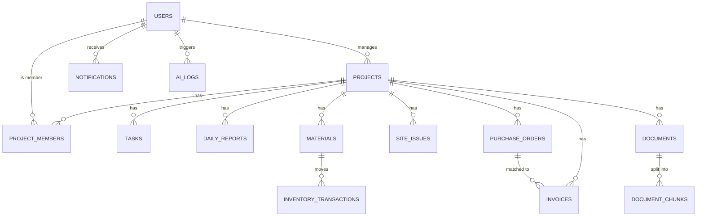

# 03 — Database Design

Database: `siteops` (configurable via `MONGODB_DB`).
Conventions:

- `_id` is an ObjectId; serialized to the client as `id` (hex string) by response schemas. Raw documents are never returned.
- All timestamps are UTC `datetime`; date-only business fields use `YYYY-MM-DD` strings to avoid timezone drift.
- Money is stored as **integer minor units** (`*_minor`, paise) plus a `currency` field. No floats for currency.
- Quantities are `Decimal128` with 3 decimal places; unit-specific display precision is a UI concern.
- Every project-scoped collection has `project_id` as an ObjectId and an index starting with it.
- Writes that matter (approvals, verifications, stock) append to `audit_logs` and/or immutable history collections.

---

## 1. Entity relationships



---

## 2. Collections

### 2.1 `users`

| Field | Type | Notes |
|---|---|---|
| `_id` | ObjectId | |
| `name` | string | 2–80 chars |
| `email` | string | lowercased, unique |
| `password_hash` | string | Argon2id; never serialized |
| `role` | enum | `project_manager` \| `site_engineer` \| `supervisor` \| `storekeeper` |
| `phone` | string? | E.164-ish, optional |
| `is_active` | bool | default true; false blocks login and token use |
| `must_change_password` | bool | true for seeded demo users in production demos |
| `last_login_at` | datetime? | |
| `created_at`, `updated_at` | datetime | |

**Indexes**

```
{ email: 1 } unique
{ role: 1, is_active: 1 }
```

### 2.2 `projects`

| Field | Type | Notes |
|---|---|---|
| `name` | string | |
| `code` | string | short human code, unique per DB (e.g. `SAM-2026-01`) |
| `description` | string | |
| `client_name` | string | fictional in demo |
| `location` | string | |
| `project_type` | enum | `interior` \| `auditorium` \| `electrical` \| `cctv` \| `fire_alarm` \| `av` \| `networking` \| `bms` \| `mixed` |
| `start_date`, `expected_end_date` | date | `expected_end_date >= start_date` |
| `actual_end_date` | date? | set when status → completed |
| `status` | enum | `planning` \| `active` \| `on_hold` \| `completed` \| `cancelled` |
| `manager_id` | ObjectId | FK users; must have role `project_manager` |
| `progress_percent` | int 0–100 | cached rollup from tasks; recomputed on task change |
| `delay_flag` | bool | derived: any task overdue or manual flag |
| `delay_reason` | string? | required when `delay_flag` set manually |
| `created_by` | ObjectId | |
| `created_at`, `updated_at` | datetime | |

**Indexes**

```
{ code: 1 } unique
{ manager_id: 1, status: 1 }
{ status: 1, expected_end_date: 1 }
```

### 2.3 `project_members`

Membership is the **single source of truth** for project access.

| Field | Type | Notes |
|---|---|---|
| `project_id` | ObjectId | |
| `user_id` | ObjectId | |
| `project_role` | enum? | optional override of `users.role` for this project |
| `added_by` | ObjectId | |
| `added_at` | datetime | |

**Indexes**

```
{ project_id: 1, user_id: 1 } unique
{ user_id: 1, project_id: 1 }
```

### 2.4 `tasks`

| Field | Type | Notes |
|---|---|---|
| `project_id` | ObjectId | |
| `title` | string | 3–140 chars |
| `description` | string? | |
| `category` | enum | matches issue categories plus `procurement`, `commissioning` |
| `location` | string? | floor/zone |
| `assigned_to` | ObjectId? | must be project member |
| `start_date`, `due_date` | date | `due >= start` |
| `estimated_days` | int? | |
| `completed_at` | datetime? | |
| `status` | enum | `not_started` \| `in_progress` \| `blocked` \| `completed` \| `cancelled` |
| `progress` | int 0–100 | forced 100 when `completed` |
| `dependencies` | ObjectId[] | must reference tasks in the same project; cycle detection on write |
| `weight` | int 1–10 | default 1; drives project rollup |
| `created_by` | ObjectId | |
| `created_at`, `updated_at` | datetime | |

**Indexes**

```
{ project_id: 1, status: 1, due_date: 1 }
{ project_id: 1, assigned_to: 1 }
{ project_id: 1, category: 1 }
```

### 2.5 `daily_reports`

| Field | Type | Notes |
|---|---|---|
| `project_id` | ObjectId | |
| `report_date` | date | not in the future |
| `submitted_by` | ObjectId | |
| `location` | string | floor/zone |
| `activities` | string | free text |
| `work_completed` | string[] | |
| `work_pending` | string[] | |
| `workers_present` | object | `{ total: int, by_trade: [{trade, count}] }` |
| `materials_consumed` | object[] | `[{material_id?, name, quantity: Decimal128, unit}]` (informational; stock moves via inventory transactions) |
| `equipment_used` | string[] | |
| `delays` | string? | |
| `safety_observations` | string? | |
| `notes` | string? | |
| `photos` | object[] | `[{file_id, storage_key, caption?, width, height}]` |
| `ai_summary` | string? | readable summary; labeled AI-generated in UI |
| `ai_assisted` | bool | true if any field was AI-proposed |
| `status` | enum | `draft` \| `submitted` \| `approved` \| `rejected` |
| `submitted_at` | datetime? | |
| `approved_by` | ObjectId? | must be project manager |
| `approved_at` | datetime? | |
| `rejection_reason` | string? | required on reject |
| `created_at`, `updated_at` | datetime | |

**Indexes**

```
{ project_id: 1, report_date: -1 }
{ project_id: 1, status: 1, submitted_at: -1 }
{ submitted_by: 1, created_at: -1 }
```

No uniqueness on `(project_id, report_date)` — multiple engineers may file on the same day; the UI groups them.

### 2.6 `materials`

| Field | Type | Notes |
|---|---|---|
| `project_id` | ObjectId | |
| `name` | string | |
| `sku` | string? | |
| `category` | enum | `electrical` \| `cctv` \| `networking` \| `fire_safety` \| `av` \| `acoustic` \| `civil` \| `bms` \| `consumables` \| `other` |
| `unit` | enum | `pcs` \| `m` \| `box` \| `roll` \| `kg` \| `ltr` \| `set` \| `sqm` |
| `opening_stock` | Decimal128 | set once at creation |
| `current_stock` | Decimal128 | ≥ 0 unless an authorized adjustment override |
| `reorder_level` | Decimal128 | |
| `supplier` | string? | |
| `unit_cost_minor` | int? | paise |
| `is_active` | bool | soft delete; transactions remain |
| `created_by` | ObjectId | |
| `created_at`, `updated_at` | datetime | |

**Indexes**

```
{ project_id: 1, name: 1 } unique
{ project_id: 1, category: 1 }
{ project_id: 1, current_stock: 1, reorder_level: 1 }
```

`current_stock` is a cache of the transaction ledger, guarded by invariants in §4.

### 2.7 `inventory_transactions` (immutable)

| Field | Type | Notes |
|---|---|---|
| `project_id`, `material_id` | ObjectId | |
| `type` | enum | `opening` \| `receipt` \| `consumption` \| `return` \| `wastage` \| `adjustment` |
| `quantity` | Decimal128 | always > 0; direction comes from `type` |
| `unit` | enum | snapshot of material unit at time of transaction |
| `stock_before`, `stock_after` | Decimal128 | ledger proof |
| `reference_type` | enum? | `purchase_order` \| `invoice` \| `task` \| `daily_report` \| `manual` |
| `reference_id` | ObjectId? | |
| `remarks` | string? | |
| `created_by` | ObjectId | |
| `created_at` | datetime | |

**Indexes**

```
{ project_id: 1, material_id: 1, created_at: -1 }
{ project_id: 1, created_at: -1 }
{ reference_type: 1, reference_id: 1 }
```

No update or delete routes exist. Corrections are `adjustment` rows with a reason.

### 2.8 `site_issues`

| Field | Type | Notes |
|---|---|---|
| `project_id` | ObjectId | |
| `title` | string | |
| `description` | string | |
| `location` | string? | |
| `category` | enum | `electrical` \| `cctv` \| `fire_safety` \| `av` \| `acoustic` \| `networking` \| `bms` \| `civil` \| `material_shortage` \| `equipment_failure` \| `other` |
| `priority` | enum | `low` \| `medium` \| `high` \| `critical` |
| `severity` | enum | `minor` \| `moderate` \| `major` \| `safety` |
| `status` | enum | `open` \| `assigned` \| `in_progress` \| `waiting` \| `resolved` \| `closed` |
| `reported_by` | ObjectId | |
| `assigned_to` | ObjectId? | |
| `due_date` | date? | |
| `photos` | object[] | same shape as report photos |
| `resolution_notes` | string? | required to resolve |
| `ai_suggestion` | object? | `{category, priority, severity, impact, next_action, confidence, model, prompt_version, accepted: bool, edited_fields: string[]}` |
| `resolved_at`, `closed_at` | datetime? | |
| `created_at`, `updated_at` | datetime | |

**Indexes**

```
{ project_id: 1, status: 1, priority: -1 }
{ project_id: 1, assigned_to: 1, status: 1 }
{ project_id: 1, category: 1 }
```

### 2.9 `purchase_orders`

| Field | Type | Notes |
|---|---|---|
| `project_id` | ObjectId | |
| `po_number` | string | unique per project |
| `vendor` | string | |
| `po_date` | date | |
| `items` | object[] | `[{description, material_id?, quantity, unit, unit_price_minor, line_total_minor}]` |
| `subtotal_minor`, `tax_minor`, `total_minor` | int | computed server-side |
| `currency` | string | default `INR` |
| `status` | enum | `open` \| `partially_received` \| `received` \| `cancelled` |
| `created_by` | ObjectId | |
| `created_at`, `updated_at` | datetime | |

**Indexes**

```
{ project_id: 1, po_number: 1 } unique
{ project_id: 1, vendor: 1, po_date: -1 }
```

### 2.10 `invoices`

| Field | Type | Notes |
|---|---|---|
| `project_id` | ObjectId | |
| `vendor` | string? | extracted or manual |
| `invoice_number` | string? | |
| `invoice_date` | date? | |
| `purchase_order_id` | ObjectId? | chosen by user or matched by `po_number` |
| `file` | object | `{storage_key, filename, mime, size_bytes, sha256}` |
| `extracted_items` | object[] | `[{description, quantity, unit, unit_price_minor, line_total_minor}]` |
| `ai_extraction` | object? | raw validated model output + model + prompt_version + confidence |
| `computed` | object | deterministic: `{line_totals[], subtotal_minor, tax_minor, total_minor}` |
| `stated` | object | values as written on the invoice: `{subtotal_minor?, tax_minor?, total_minor?}` |
| `discrepancies` | object[] | `[{code, field, expected, found, severity, message}]` |
| `currency` | string | |
| `verification_status` | enum | `uploaded` \| `extracting` \| `extracted` \| `needs_review` \| `verified` \| `rejected` \| `failed` |
| `verification` | object? | `{decision, notes, by, at, field_snapshot}` |
| `error` | object? | `{code, message}` for failures |
| `uploaded_by` | ObjectId | |
| `created_at`, `updated_at` | datetime | |

**Indexes**

```
{ project_id: 1, verification_status: 1, created_at: -1 }
{ project_id: 1, invoice_number: 1 }
{ project_id: 1, purchase_order_id: 1 }
```

`invoice_number` is not unique: suppliers repeat numbers, and duplicates must be flagged, not blocked.

### 2.11 `documents`

| Field | Type | Notes |
|---|---|---|
| `project_id` | ObjectId | |
| `filename` | string | original, sanitized for display |
| `storage_key` | string | generated UUID path, never user-controlled |
| `mime`, `size_bytes`, `sha256` | | |
| `category` | enum | `specification` \| `manual` \| `drawing` \| `procedure` \| `contract` \| `other` |
| `processing_status` | enum | `uploaded` \| `processing` \| `ready` \| `failed` |
| `pages` | int? | |
| `chunk_count` | int? | |
| `chroma_collection` | string | `proj_<project_id>` |
| `error` | object? | |
| `uploaded_by`, `created_at`, `updated_at` | | |

**Indexes**

```
{ project_id: 1, created_at: -1 }
{ project_id: 1, sha256: 1 } unique   // dedupe per project
{ project_id: 1, processing_status: 1 }
```

### 2.12 `document_chunks`

| Field | Type | Notes |
|---|---|---|
| `project_id`, `document_id` | ObjectId | |
| `chunk_index` | int | 0-based within document |
| `page` | int? | first page of the chunk; ranges when spanning pages |
| `text` | string | chunk text (needed for citations and re-embedding) |
| `token_count` | int | estimate |
| `embedding_id` | string | Chroma vector ID, `"{document_id}:{chunk_index}"` |
| `embedding_model` | string | |
| `created_at` | datetime | |

**Indexes**

```
{ document_id: 1, chunk_index: 1 } unique
{ project_id: 1, document_id: 1 }
```

Vector payload in Chroma per chunk: `{project_id, document_id, filename, page, chunk_index}`. Retrieval filters on `project_id` **and** is scoped to the project collection, so two independent controls must fail before a leak occurs.

### 2.13 `notifications`

| Field | Type | Notes |
|---|---|---|
| `user_id` | ObjectId | recipient |
| `project_id` | ObjectId? | |
| `type` | enum | `report_submitted` \| `report_approved` \| `report_rejected` \| `issue_assigned` \| `low_stock` \| `invoice_verified` \| `document_ready` |
| `title`, `body` | string | |
| `link` | string? | internal route |
| `read_at` | datetime? | |
| `created_at` | datetime | |

**Indexes**

```
{ user_id: 1, read_at: 1, created_at: -1 }
{ created_at: 1 }   // TTL 90 days, expireAfterSeconds
```

### 2.14 `ai_logs`

| Field | Type | Notes |
|---|---|---|
| `user_id` | ObjectId? | |
| `project_id` | ObjectId? | |
| `feature` | enum | `report_generate` \| `voice_transcribe` \| `issue_classify` \| `invoice_extract` \| `project_chat` \| `document_qa` \| `forecast_explain` \| `delay_explain` |
| `provider`, `model` | string | |
| `prompt_version` | string | e.g. `report.v1` |
| `status` | enum | `success` \| `error` \| `fallback` \| `invalid_output` |
| `error_code` | string? | |
| `latency_ms` | int | |
| `prompt_tokens`, `completion_tokens` | int? | when provider reports usage |
| `input_chars`, `output_chars` | int | size telemetry without storing content |
| `request_id` | string | correlates with HTTP logs |
| `created_at` | datetime | |

**Indexes**

```
{ created_at: -1 }
{ project_id: 1, feature: 1, created_at: -1 }
{ user_id: 1, created_at: -1 }
```

Raw prompts and documents are **not** stored by default. Setting `AI_LOG_PROMPTS=true` (development only) adds a redacted `debug` object with 7-day TTL.

### 2.15 `audit_logs`

| Field | Type | Notes |
|---|---|---|
| `actor_id` | ObjectId | |
| `project_id` | ObjectId? | |
| `action` | string | e.g. `report.approve`, `invoice.verify`, `inventory.adjust`, `member.add` |
| `entity_type`, `entity_id` | string, ObjectId | |
| `before`, `after` | object? | field-level diff for consequential actions |
| `request_id`, `ip_hash` | | |
| `created_at` | datetime | |

**Indexes**

```
{ entity_type: 1, entity_id: 1, created_at: -1 }
{ actor_id: 1, created_at: -1 }
{ created_at: -1 }   // TTL 365 days
```

---

## 3. Index creation

`app/database/indexes.py` runs idempotently on startup (`create_indexes`), creating every index above by name. Startup fails loudly if a unique index cannot be built (e.g., duplicate emails from bad seed data) rather than silently degrading.

Indexes are declared in one table (`INDEX_SPECS`) with `collection`, `keys`, `unique`, `ttl`, so tests can assert the DB matches the spec.

---

## 4. Invariants and enforcement

| Invariant | Enforcement |
|---|---|
| Email uniqueness | unique index + pre-check for friendly 409 |
| `current_stock >= 0` | guarded `findOneAndUpdate` (`$gte` on consumption); negative requires `allow_negative=true` from a manager, still logged |
| Closing stock ledger identity | recomputed in tests and a `GET /inventory/reconcile` diagnostic (manager only) |
| Transaction immutability | no update/delete repository methods |
| Report approval only by manager | service check + role dependency; audit entry |
| Invoice totals | computed from items in Python; `stated` kept separately; UI shows both |
| Task dependency cycles | DFS before write, 422 `TASK_DEPENDENCY_CYCLE` |
| Date sanity | `due_date >= start_date`, `report_date <= today`, `invoice_date` within ±5 years |
| Cross-project references | every referenced ID is loaded and checked for identical `project_id` |
| Documents dedupe | unique `(project_id, sha256)` |

---

## 5. Aggregations used by analytics

Named pipelines implemented in `services/analytics.py`:

1. **`project_kpis`** — `$match` on authorized project IDs + date range → `$facet` for counts by status, open/critical issues, low stock, pending approvals.
2. **`progress_series`** — daily reports grouped by `report_date`, summing completed activities and workers.
3. **`issue_distribution`** — `$group` by `status` and `priority`.
4. **`inventory_usage`** — `inventory_transactions` filtered to `consumption`, grouped by material and week.
5. **`task_completion`** — `$group` by status and category, plus overdue count (`due_date < today AND status != completed`).

All pipelines project only needed fields and use `$limit` where a chart cannot render more.

---

## 6. Seed data (Phase 2)

One command: `python -m app.scripts.seed --reset`. It is idempotent by deterministic natural keys (`users.email`, `projects.code`, `materials (project_id,name)`, `purchase_orders.po_number`).

- 1 project: Smart Auditorium Modernization, client Demo Educational Institution, Bengaluru.
- 6 users (1 PM, 2 engineers, 2 supervisors, 1 storekeeper) with passwords from `DEMO_PASSWORD`.
- 20 materials across electrical/CCTV/fire/AV/acoustic/networking.
- 15 tasks with 2 dependency chains and 3 deliberately overdue.
- 10 issues spanning categories and statuses, 2 critical.
- 10 daily reports over 2 weeks, mixed statuses, 2 pending approval.
- 5 invoices: 2 clean, 1 price mismatch, 1 quantity mismatch, 1 unreadable scan.
- 5 documents (2 specs, 1 manual, 1 procedure, 1 contract) with pre-chunked text for RAG.
- 40 inventory transactions producing a consistent ledger and 3 low-stock items.

Seed data is marked with `is_demo: true` on projects and users, and the frontend shows a persistent "Demo data" banner.

---

## 7. Retention and backups

| Data | Retention |
|---|---|
| Audit logs | 365 days (TTL) |
| AI logs | 180 days (TTL) |
| Notifications | 90 days (TTL), read or not |
| Files | Until project deleted; deletion is a soft archive in v1 (documented) |
| Transactions | Permanent (no TTL) |

Atlas: daily snapshot on the free tier where available; `.env`-driven `mongodump` instructions in the deployment guide for a manual backup.
